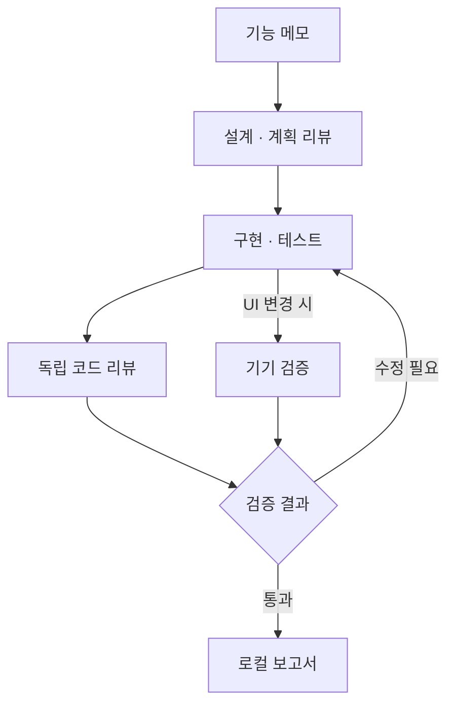

# my-skills

[English](README.md) · **한국어**

Codex나 Claude Code에 기능 메모를 건네면 설계부터 구현과 검증까지 진행합니다. 코드 리뷰 의견, 테스트 결과, 기기에서 확인한 화면은 로컬 HTML 보고서 한 곳에서 볼 수 있습니다.



## 설치

Git과 Node.js 20 이상이 필요합니다. Android UI를 확인할 때는 adb와 승인된 기기 또는 에뮬레이터를 사용합니다.

### Codex

하위 에이전트를 지원하는 Codex에서 설치합니다.

```sh
codex plugin marketplace add Cjsghkd/my-skills
codex plugin add my-skills@my-skills
```

작업할 프로젝트에서 새 Codex 대화를 엽니다. 프로젝트 역할 등록이 필요한 클라이언트에서는 “이 저장소에 my-oc-flow 역할을 설정해줘”라고 요청한 뒤 새 대화를 시작하세요.

### Claude Code

```sh
claude plugin marketplace add Cjsghkd/my-skills
claude plugin install my-skills@my-skills
```

대상 프로젝트에서 새 Claude Code 대화를 열고 `/my-skills:my-oc-flow`를 호출합니다. 역할 10개는 플러그인에 포함됩니다.

## 사용 예

**Codex**

> $my-oc-flow 앱을 닫았다가 다시 열면 작성하던 초안을 복원해줘. 같은 기기에서만 유지되면 돼.

**Claude Code**

> /my-skills:my-oc-flow 앱을 닫았다가 다시 열면 작성하던 초안을 복원해줘. 같은 기기에서만 유지되면 돼.

테스트에서 `장보기`라고 입력했다면 앱을 종료했다 다시 연 뒤에도 초안에 `장보기`가 있어야 합니다. 이 한 가지 기준을 설계자, 리뷰어, 기기 검증 담당이 함께 사용합니다.

## 메모에서 검증까지

1. **조사와 완료 기준.** 기존 진입점과 호출부를 따라가 현재 동작을 확인합니다. 메모에서 사용자가 관찰할 수 있는 결과를 뽑고, 제품 동작을 결정해야 할 때만 질문합니다. 초안 복원이라면 먼저 초안이 저장되는 시점과 다시 읽히는 시점을 찾습니다.
2. **독립 설계와 계획 리뷰.** 설계자 두 명이 같은 메모와 코드를 보고 각자 변경 범위, 유지할 동작, 실패 경로, 기준별 테스트를 제안합니다. 두 안을 합칠 때 선택 근거와 이견을 남깁니다. 이어서 새 리뷰어 두 명이 계획을 검토합니다. 예를 들어 앱을 다시 열기만 하는 테스트라면, 복원 기능이 빠져도 통과하므로 저장한 문장까지 대조하도록 계획을 고칩니다.
3. **구현과 실행 검증.** 별도 구현 세션이 합의한 계획에 따라 코드를 수정하고 실제 diff를 남깁니다. 검증 담당은 그 변경본에서 빌드와 테스트를 실행하고 명령, 기대값, 관찰값을 기록합니다. 실행 환경이 막힌 경우에는 해당 기준을 미확인으로 남깁니다.
4. **코드 리뷰와 재검증.** 새 코드 리뷰어 두 명이 같은 변경본의 호출부, 기존 데이터, 테스트를 독립적으로 살핍니다. UI에 영향이 있으면 같은 빌드로 기기 검증도 진행합니다. 채택된 지적은 구현 단계로 돌려보내고, 수정 후 영향받은 검사를 다시 실행합니다. 필요한 검사를 모두 통과해야 작업을 완료합니다.

### 반박자는 언제 참여하나요?

계획 리뷰와 코드 리뷰에는 같은 판정 규칙을 적용합니다. 한 사람만 문제를 제기하면 다른 리뷰어도 같은 코드나 재현 기록을 확인합니다. 두 사람이 동의하면 수정하고, 모두 기각하면 이유를 남깁니다. **같은 지적에 한쪽은 채택, 다른 쪽은 기각했을 때만** 별도 반박자(`arbiter`)가 양쪽 근거를 독립적으로 확인해 판정합니다. 재현이나 코드 근거가 부족하면 미확인으로 남고, 제품 정책 선택은 사용자에게 돌아갑니다.

## 단계별 모델과 추론 강도

**메인 세션**은 호출한 Codex 또는 Claude Code 대화의 모델과 추론 강도를 그대로 사용합니다. 아래 값은 플러그인이 각 하위 역할에 지정하는 기본값입니다. Claude Code의 모델 별칭과 실제 적용되는 추론 강도는 제공자, 모델 지원 범위, 사용자 설정에 따라 달라질 수 있습니다.

| 단계 | Codex 모델 / effort | Claude Code 모델 / effort |
| --- | --- | --- |
| 기존 동작 조사 | `gpt-6.1-terra / low` | `sonnet / medium` |
| 완료 기준 해석이 필요할 때 | `gpt-6.2-sol / medium` | `sonnet / medium` |
| 독립 설계 (2개 세션) | `gpt-6.2-sol / medium` | `sonnet / high` |
| 설계안 검토 (2개 세션) | `gpt-6.2-sol / medium` | `sonnet / medium` |
| 구현 및 수정 | `gpt-6.2-sol / medium` | `sonnet / medium` |
| 빌드 및 테스트 실행 | `gpt-6.1-terra / low` | `haiku / low` |
| 독립 코드 리뷰 (2개 세션) | `gpt-6.2-sol / medium` | `sonnet / high` |
| UI 변경 시 기기 경로 기록·재생 | `gpt-6.1-terra / low` | `haiku / low` |
| 캡처로 화면 상태를 판정해야 할 때 | `gpt-6.2-sol / medium` | `sonnet / medium` |
| 리뷰 판정이 채택·기각으로 갈릴 때 | `gpt-6.2-sol / high` | `opus / high` |

[Codex 역할](plugins/my-skills/skills/my-oc-flow/roles.json) · [Claude Code 에이전트](plugins/my-skills-claude/agents)

## Android 기기에서 기록하고 재생하는 방법

Codex에서 저장한 경로는 Claude Code에서도 재생할 수 있고 그 반대도 가능합니다. 경로는 화면에서 확인할 **사용자 동작과 그 결과**를 한 쌍으로 저장합니다. 같은 초안 화면에서도 ‘초안 복원’과 ‘초안 삭제’는 다른 경로입니다. 작업 때마다 직접 영향을 받는 동작만 조회하므로 프로젝트의 경로는 실제로 작업한 만큼 쌓입니다.

- **기존 경로.** 시작 조건과 마지막 기대값이 이번 기준과 맞으면 현재 빌드에서 한 번 재생합니다. 초안 복원이라면 앱을 다시 열고 저장해 둔 문장이 실제로 표시되는지 확인합니다.
- **새 경로.** `learn`으로 후보 절차를 한 번 실행합니다. 테스트 데이터와 화면을 기록한 시작 상태로 돌린 뒤, 같은 기기와 변경본에서 `confirm`으로 동일한 절차를 다시 실행합니다. 두 번 모두 통과한 경로만 `docs/flows/<화면>/<동작>.android.json`에 저장합니다.
- **재생 실패.** 첫 실패 기록과 기존 경로를 보존합니다. 기기·계정 상태가 원인이면 환경을 복원하고, 제품 결함이면 수정한 빌드에서 원래 경로를 재생합니다. 의도적으로 UI가 바뀌었을 때는 새 절차를 두 번 검증해 교체합니다. 잘림이나 겹침은 실제 캡처로 확인합니다.

## 결과 확인

`.flow/<id>/report/index.html`에서 완료 기준별 결과, 변경 내용, 리뷰 의견과 판정 근거를 확인할 수 있습니다. 재사용할 경로는 프로젝트에 두고, 이번 실행의 로그와 스크린샷은 `.flow/<id>/evidence/`에 보관합니다. 보고서에는 측정된 단계의 실행 시간과 입력·캐시 입력·출력 토큰이 표시됩니다. 미확인 항목이 남으면 불완료 보고서를 제공합니다. 기존 리뷰어에게 다시 의견을 받을 수 있도록 작업을 시작한 대화에서 `$my-oc-flow <id> 이어서 진행해줘` 또는 `/my-skills:my-oc-flow <id> 이어서 진행해줘`로 재개하세요. [예제 보고서](examples/greeting.html)

[MIT 라이선스](LICENSE)
