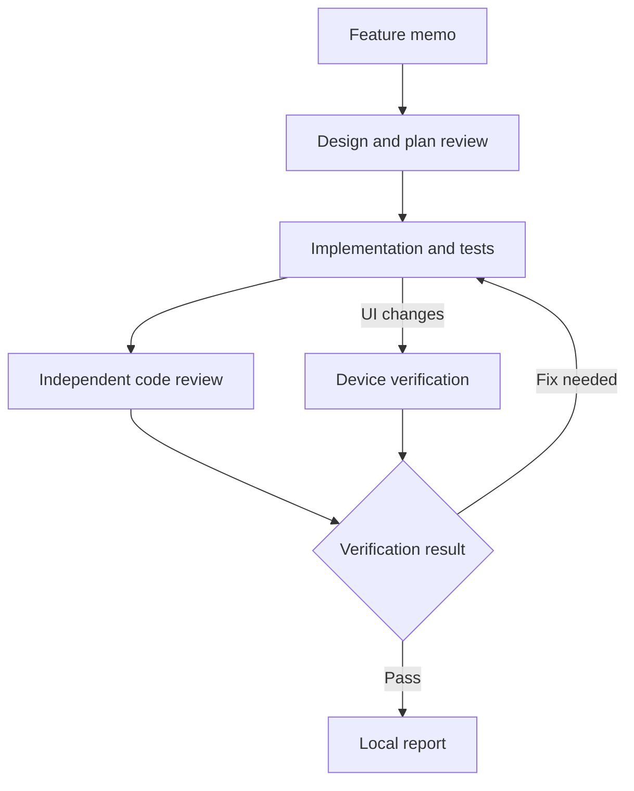

# my-skills

**English** · [한국어](README.ko.md)

Give `$my-oc-flow` a feature memo in Codex. It takes the change through design, implementation, and verification, then brings the code reviews, test results, and UI evidence together in a local HTML report.



## Install

You need Git, Node.js 20+, and a Codex client with sub-agent support. Android checks also use adb and an authorized device or emulator.

```sh
codex plugin marketplace add Cjsghkd/my-skills --ref v0.2.0
codex plugin add my-skills@my-skills
```

**Updating from v0.1.0?** Run `codex plugin marketplace remove my-skills` first, then run both commands above. Check the installed version with `codex plugin list --marketplace my-skills --json` and start a new Codex chat.

To use a local checkout, replace the first command with `codex plugin marketplace add /path/to/my-skills`. Open a new Codex chat in the project you want to change. If your client requires project roles, ask it to “Set up the my-oc-flow roles in this repository,” then start a new chat.

## Try it

> $my-oc-flow Restore the current draft when I close and reopen the app. The draft only needs to survive on this device.

If the test enters `Buy groceries`, the draft must still contain `Buy groceries` after the app closes and reopens. Designers, reviewers, and the device operator all work from that criterion.

## From memo to verified change

1. **Survey and acceptance criteria.** The survey traces the existing entry points and callers. The memo becomes a set of observable outcomes. A question goes back to the user when a product decision is needed. For draft restoration, the first step is to find when the app saves the draft and when it reads it back.
2. **Independent designs and plan review.** Two designers work from the same memo and code. Each proposes a change, identifies behavior to preserve and failure cases, and specifies a test for each criterion. The combined plan keeps the rationale and any disagreements. Two fresh reviewers then check whether a broken implementation could pass. In the draft example, they would ask the test to compare the saved text after relaunch.
3. **Implementation and execution.** A separate implementer applies the agreed plan and records the diff. A verifier builds and tests that revision, recording the commands, expected outcomes, and observations. A check blocked by the environment stays unverified.
4. **Code review and rechecks.** Two fresh reviewers independently inspect the callers, existing data, and tests on the same revision. UI changes also get a device check on that build. Accepted findings go back to implementation. The affected checks run again after a fix, and the run is complete once all required checks pass.

### When does the arbiter step in?

Plan and code reviews use the same rule. When one reviewer raises an issue, the other examines the same code or reproduction. Agreement on a defect sends it back for a fix. If both dismiss it, the report keeps their reasoning. **Only an explicit accept–reject split on the same finding** triggers a separate arbiter, who checks the evidence independently. A finding can remain unresolved when the evidence is insufficient. Product policy decisions go back to the user.

## Models and reasoning effort by stage

**The main session** uses the model and reasoning effort currently selected in the Codex chat where you invoke `$my-oc-flow`. It coordinates scope with you, delegates work, and brings the findings back to the chat.

The table shows the [subagent roles shipped with the plugin](plugins/my-skills/skills/my-oc-flow/roles.json). Each session receives the relevant criteria and paths to the code and evidence.

| Stage | Subagent role | Model | Effort |
| --- | --- | --- | --- |
| Survey existing behavior | `survey` | `gpt-6.1-terra` | `low` |
| Clarify ambiguous acceptance criteria | `criteria` | `gpt-6.2-sol` | `medium` |
| Independent designs (2 sessions) | `design` | `gpt-6.2-sol` | `medium` |
| Plan review (2 sessions) | `plan_review` | `gpt-6.2-sol` | `medium` |
| Implementation and fixes | `implement` | `gpt-6.2-sol` | `medium` |
| Run builds and tests | `verify` | `gpt-6.1-terra` | `low` |
| Independent code review (2 sessions) | `code_review` | `gpt-6.2-sol` | `medium` |
| Record or replay device checks for UI changes | `device` | `gpt-6.1-terra` | `low` |
| Assess screenshots when a visual check is needed | `visual` | `gpt-6.2-sol` | `medium` |
| Resolve an explicit accept–reject split | `arbiter` | `gpt-6.2-sol` | `high` |

## Recording and replaying an Android check

A route pairs a **user action with its expected outcome**. Restoring and deleting a draft are separate checks even though they use the same screen. Each task looks up just the affected actions, so the project builds its collection as features are changed.

- **Existing route.** If the starting conditions and final assertion match, replay it once on the current build. For draft restoration, reopen the app and check that it displays the saved text.
- **New route.** Run the candidate steps once with `learn`. Restore the test data and screen to the documented starting state, then run the identical candidate with `confirm` on the same device and revision. After both passes, the route is saved to `docs/flows/<screen>/<action>.android.json`.
- **Failed replay.** Keep the original route and evidence from the first failure. Restore the device or account state for an environment problem. For a product defect, fix the app and replay the original route. When an intentional UI change calls for different steps, verify the replacement twice before saving it. Inspect a capture for issues such as clipping or overlapping text.

## Results

Open `.flow/<id>/report/index.html` to see outcomes by criterion, code changes, review findings, and the reasons for each decision. Reusable routes live in the project. Logs and screenshots for the run live under `.flow/<id>/evidence/`. Where measured, the report shows elapsed time and input, cached input, and output tokens by stage. Outstanding checks appear in an incomplete report. To resume, ask `$my-oc-flow Resume <id>`. [Example report (Korean)](examples/greeting.html)

[MIT license](LICENSE)
